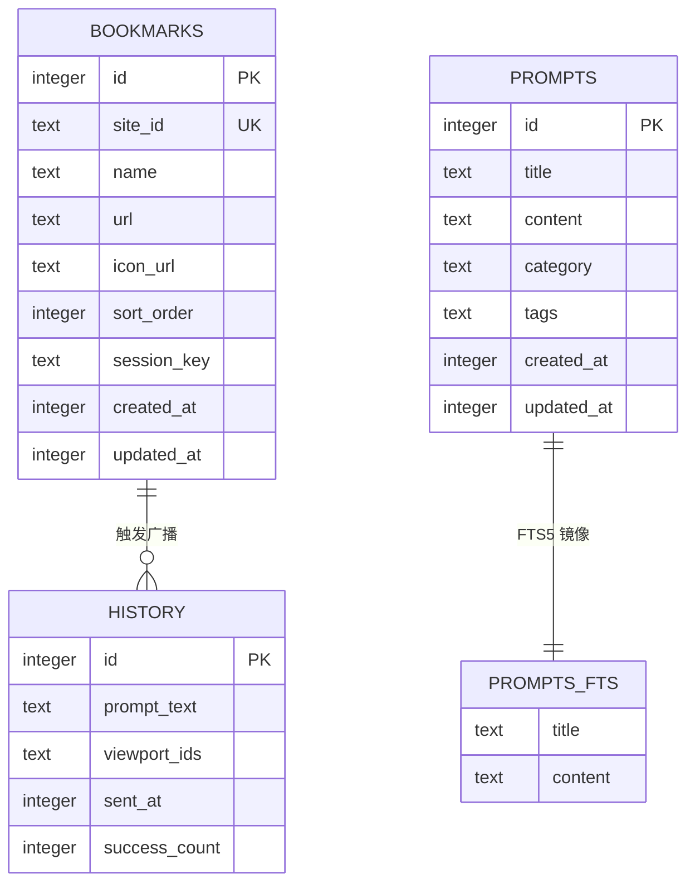

# 数据库设计（Data）

> 文件路径：`docs/spec/versions/v1/data.md`
> 版本：v1 · 日期：2026-11-01
> 数据库：SQLite（`modernc.org/sqlite`，纯 Go 无 CGO）
> 数据库文件：`%APPDATA%/AIMux/aimux.db`（Windows）/ `~/Library/Application Support/AIMux/aimux.db`（macOS）

---

## 1. 数据实体关系



---

## 2. 表定义

### 2.1 bookmarks — AI 站点书签

```sql
CREATE TABLE IF NOT EXISTS bookmarks (
    id          INTEGER PRIMARY KEY AUTOINCREMENT,
    site_id     TEXT    NOT NULL UNIQUE,      -- 全局唯一站点标识（URL slug）
    name        TEXT    NOT NULL,             -- 显示名称，如 "ChatGPT"
    url         TEXT    NOT NULL,             -- 站点 URL，如 "https://chat.openai.com"
    icon_url    TEXT,                         -- favicon URL（可为空，降级使用默认图标）
    sort_order  INTEGER NOT NULL DEFAULT 0,  -- 用户自定义排序
    session_key TEXT    NOT NULL,             -- UserDataPath 目录名（不含完整路径）
    created_at  INTEGER NOT NULL,             -- Unix 时间戳（秒）
    updated_at  INTEGER NOT NULL
);
CREATE INDEX IF NOT EXISTS idx_bookmarks_sort ON bookmarks(sort_order);
```

### 2.2 prompts — Prompt 知识库

```sql
CREATE TABLE IF NOT EXISTS prompts (
    id          INTEGER PRIMARY KEY AUTOINCREMENT,
    title       TEXT    NOT NULL,
    content     TEXT    NOT NULL,
    category    TEXT    DEFAULT '',           -- 分类标签
    tags        TEXT    DEFAULT '[]',         -- JSON 数组格式
    created_at  INTEGER NOT NULL,
    updated_at  INTEGER NOT NULL
);

-- FTS5 全文检索虚拟表（title + content 双字段检索）
CREATE VIRTUAL TABLE IF NOT EXISTS prompts_fts USING fts5(
    title,
    content,
    content='prompts',
    content_rowid='id'
);

-- 保持 FTS 索引与主表同步的触发器
CREATE TRIGGER IF NOT EXISTS prompts_ai AFTER INSERT ON prompts BEGIN
    INSERT INTO prompts_fts(rowid, title, content) VALUES (new.id, new.title, new.content);
END;
CREATE TRIGGER IF NOT EXISTS prompts_ad AFTER DELETE ON prompts BEGIN
    INSERT INTO prompts_fts(prompts_fts, rowid, title, content)
        VALUES('delete', old.id, old.title, old.content);
END;
CREATE TRIGGER IF NOT EXISTS prompts_au AFTER UPDATE ON prompts BEGIN
    INSERT INTO prompts_fts(prompts_fts, rowid, title, content)
        VALUES('delete', old.id, old.title, old.content);
    INSERT INTO prompts_fts(rowid, title, content) VALUES (new.id, new.title, new.content);
END;
```

### 2.3 history — 广播历史记录

```sql
CREATE TABLE IF NOT EXISTS history (
    id            INTEGER PRIMARY KEY AUTOINCREMENT,
    prompt_text   TEXT    NOT NULL,           -- 广播的 Prompt 文本
    viewport_ids  TEXT    NOT NULL,           -- JSON 数组：被广播的视口 site_id 列表
    sent_at       INTEGER NOT NULL,           -- Unix 时间戳（秒）
    success_count INTEGER NOT NULL DEFAULT 0 -- 成功注入的视口数量
);
CREATE INDEX IF NOT EXISTS idx_history_sent_at ON history(sent_at DESC);
```

---

## 3. 配置文件 Schema（config.json）

> 路径：`%APPDATA%/AIMux/config.json`
> ⚠️ 不含明文 API Key（Key 存系统密钥链）

```json
{
  "version": "1.0.0",
  "window": {
    "preset": "2K-Comfort",
    "width": 1600,
    "height": 1000,
    "x": -1,
    "y": -1,
    "isMaximized": false,
    "lastMonitorId": "DISPLAY1",
    "rememberBounds": true
  },
  "theme": {
    "current": "Dark Obsidian",
    "mode": "dark",
    "accentColor": "#3B82F6",
    "windowOpacity": 0.85,
    "backdropBlur": 20,
    "borderRadius": 10,
    "enableMica": true
  },
  "hotkeys": {
    "globalSpotlight": "Alt+Space",
    "globalToggleMain": "Ctrl+Shift+W",
    "globalSendClipboard": "Ctrl+Shift+B",
    "switchLayout1": "Ctrl+1",
    "switchLayout2": "Ctrl+2",
    "switchLayout4": "Ctrl+3",
    "switchLayout1x4": "Ctrl+4",
    "broadcastSend": "Ctrl+Enter",
    "toggleDrawer": "Ctrl+\\",
    "openSettings": "Ctrl+,"
  },
  "layout": {
    "activeLayout": "grid4",
    "rightBarWidth": 260,
    "bottomBarHeight": 90,
    "enableAutoZoom": true,
    "autoZoomMin": 0.75
  },
  "activeViewportIds": [
    "chatgpt-default",
    "claude-default"
  ],
  "llm": {
    "providers": [
      {
        "id": "provider-uuid",
        "name": "OpenAI",
        "baseUrl": "https://api.openai.com/v1",
        "model": "gpt-4o-mini",
        "keychainKey": "aimux-llm-provider-uuid"
      }
    ],
    "activeProviderId": "provider-uuid"
  }
}
```

---

## 4. 数据迁移策略

- 迁移文件位于 `app/storage/migrations/` 目录
- 文件命名规范：`{version}_{description}.up.sql` / `{version}_{description}.down.sql`
- 示例：`000001_init_schema.up.sql`
- 应用启动时自动执行未应用的迁移（`golang-migrate/migrate`）
- 迁移版本记录在 SQLite `schema_migrations` 表中

