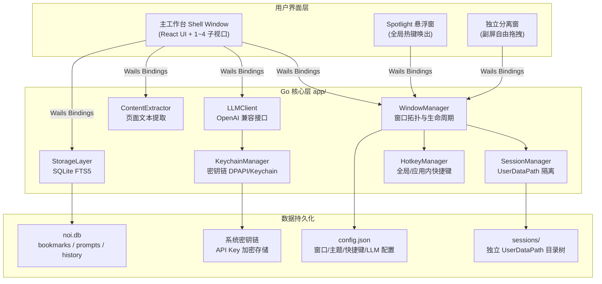
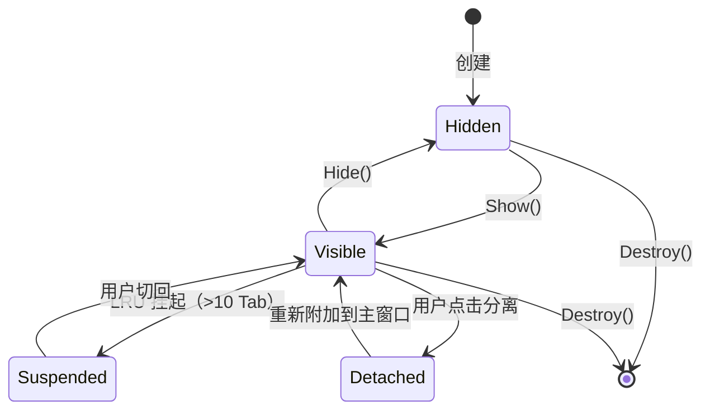
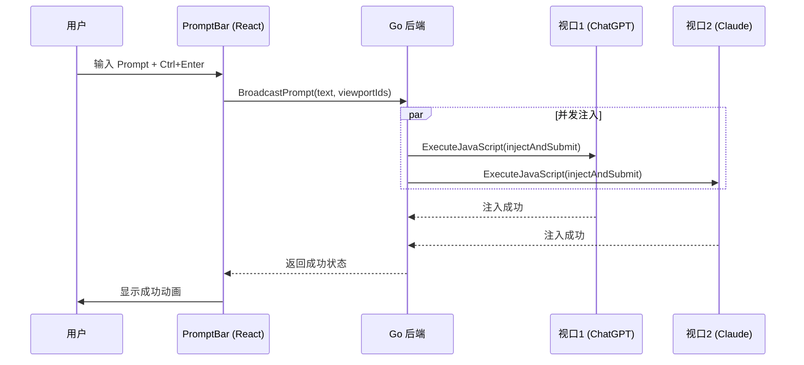
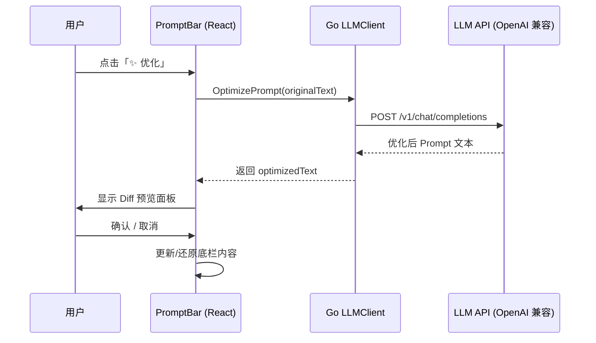

# 技术方案（Design）

> 文件路径：`docs/spec/versions/v1/design.md`
> 版本：v1 · 日期：2026-11-01
> 状态：已定稿

---

## 1. 项目结构

```
aimux/
├── main.go                         # Wails v3 应用入口，注册窗口和服务
├── app.go                          # App 结构体（Wails 绑定点）
├── go.mod / go.sum                 # Go 模块依赖
├── wails.json                      # Wails 项目配置
├── .gitattributes                  # 换行符强制 LF
├── config/                         # 全局常量（Go 侧）
│   ├── defaults.go                 # 窗口默认尺寸、Zoom 阈值等常量
│   └── paths.go                    # 应用数据路径生成
├── app/                            # Go 业务逻辑层
│   ├── window/                     # 窗口管理
│   │   ├── manager.go              # WindowManager：Shell/Spotlight/Detached 生命周期
│   │   ├── layout.go               # 布局计算（Bounds 分发）
│   │   └── dpi.go                  # DPI 感知与跨屏迁移
│   ├── hotkey/                     # 全局快捷键
│   │   ├── manager.go              # 跨平台热键注册/注销
│   │   └── conflict.go             # 冲突检测与降级
│   ├── session/                    # 会话隔离
│   │   ├── partition.go            # UserDataPath 分配策略
│   │   └── oauth.go                # OAuth 弹窗拦截
│   ├── llm/                        # LLM API 客户端
│   │   ├── client.go               # OpenAI 兼容 HTTP 客户端
│   │   ├── keychain.go             # 密钥链读写（DPAPI / Keychain）
│   │   └── optimizer.go            # Prompt 优化调用逻辑
│   ├── content/                    # 内容提取
│   │   ├── extractor.go            # 页面文本提取（注入 JS）
│   │   └── markdown.go             # 对话内容转 Markdown 格式化
│   └── storage/                    # 持久化层
│       ├── db.go                   # SQLite 连接与迁移（golang-migrate）
│       ├── migrations/             # 版本化 SQL 迁移文件
│       ├── bookmark.go             # 站点书签 CRUD
│       ├── prompt.go               # Prompt 库 CRUD + FTS5
│       └── history.go              # 广播历史记录
├── ui/                             # 前端源码（React + Vite）
│   ├── index.html
│   ├── vite.config.ts
│   ├── tsconfig.json
│   ├── src/
│   │   ├── main.tsx                # React 入口
│   │   ├── App.tsx                 # 根组件（路由/主题 Provider）
│   │   ├── config/                 # 前端常量
│   │   │   ├── viewport.ts         # Zoom 阈值、布局预设
│   │   │   └── themes.ts           # 6 款主题 Token 定义
│   │   ├── components/             # 通用 UI 组件（shadcn/ui 封装）
│   │   │   ├── Layout/             # 布局容器、Splitter
│   │   │   ├── PromptBar/          # 底栏 Prompt 输入区
│   │   │   ├── Spotlight/          # 悬浮窗输入组件
│   │   │   └── ThemeProvider/      # CSS 变量注入
│   │   ├── features/               # 功能模块
│   │   │   ├── viewport/           # 视口管理（布局/缩放/分离）
│   │   │   ├── broadcast/          # Prompt 广播注入
│   │   │   ├── sites/              # AI 站点源管理
│   │   │   ├── llm/                # LLM 设置 UI + Prompt 优化
│   │   │   ├── save-md/            # 保存为 Markdown 功能
│   │   │   └── settings/           # 设置中心（皮肤/快捷键/窗口）
│   │   ├── hooks/                  # 自定义 Hooks
│   │   ├── stores/                 # Zustand Stores
│   │   ├── types/                  # TypeScript 类型定义
│   │   └── utils/                  # 工具函数
│   └── wailsjs/                    # Wails 自动生成的 Go bindings
└── docs/                           # 开发文档
    └── spec/                       # SDD 规格文档
```

---

## 2. 架构概览

### 2.1 系统整体架构



### 2.2 多窗口生命周期状态机



### 2.3 Prompt 广播数据流



### 2.4 Prompt 优化数据流



---

## 3. 技术选型

### 3.1 桌面框架

| 维度 | 选型 | 理由 |
|------|------|------|
| 桌面框架 | Wails v3 | 多窗口一等公民；每窗口独立 UserDataPath；原生全局热键支持；无 iframe CSP 限制 |
| WebView 引擎 | 系统原生（WebView2/WKWebView/WebKitGTK） | 无需打包 Chromium，减少安装体积 100MB+ |
| 前端框架 | React 19 + TypeScript 5 | 生态成熟，组件化开发效率高 |
| 前端构建 | Vite 6 | 开发热更新快，ESM 原生支持 |

### 3.2 前端技术

| 工具 | 选型 | 理由 |
|------|------|------|
| UI 组件库 | shadcn/ui + Tailwind CSS v4 | 可定制化强，与 CSS 变量主题系统无缝集成 |
| 状态管理 | Zustand | 轻量、无样板代码，适合桌面应用状态 |
| 路由 | React Router v7 | 满足设置页面等多视图切换需求 |
| 动画 | Framer Motion | 悬浮窗弹出、主题切换等平滑动画 |
| 图标 | Lucide React | SVG 图标，轻量可定制 |

### 3.3 后端技术

| 工具 | 选型 | 理由 |
|------|------|------|
| Go 版本 | ≥ 1.22 | range over integer，更好的标准库 |
| SQLite 驱动 | `modernc.org/sqlite` | 纯 Go 实现，无 CGO，跨平台编译无障碍 |
| DB 迁移 | `golang-migrate/migrate` | 版本化 SQL 文件，可回滚 |
| HTTP 客户端 | 标准库 `net/http` | 调用 LLM API 足够，避免引入重型依赖 |
| 密钥链 | `zalando/go-keyring` | 统一封装 Windows DPAPI / macOS Keychain / Linux Secret Service |
| 日志 | `log/slog`（标准库） | 结构化日志，零外部依赖 |

### 3.4 测试工具

| 测试类型 | 框架 |
|---------|------|
| Go 单元测试 | `go test` + `testify/assert` |
| 前端单元/组件测试 | Vitest + React Testing Library |
| E2E 测试 | Playwright MCP |
| API 接口测试 | `curl` |

---

## 4. 安全性

### 4.1 API 密钥管理

- 用户输入的 LLM API Key 通过 `app/llm/keychain.go` 写入系统密钥链
- `config.json` 中只存储提供商名称、base URL 和模型名，不含明文 Key
- 日志中 API Key 必须脱敏：`sk-****`

### 4.2 会话隔离

- 每个 AI 视口通过独立 `UserDataPath` 物理隔离 Cookie、LocalStorage 和 IndexedDB
- 路径格式：`%APPDATA%/AIMux/sessions/<site-id>-<uuid>/`
- 会话目录由 `app/session/partition.go` 统一管理，禁止外部直接操作

### 4.3 反自动化指纹

- 每个视口初始化前注入 Preload 脚本清除 `navigator.webdriver` 等自动化特征
- User-Agent 统一设置为真实 Chrome 桌面版 UA，不暴露 Wails 标识

---

## 5. 数据库设计

→ 详见 [`docs/spec/versions/v1/data.md`](./data.md)

---

## 6. Go-前端接口（Wails Bindings）

> 本项目为纯桌面应用，无 HTTP 服务端。前后端通信通过 Wails Bindings（Go 函数暴露给前端调用）实现。
> → 详见 [`docs/spec/versions/v1/api.md`](./api.md)

